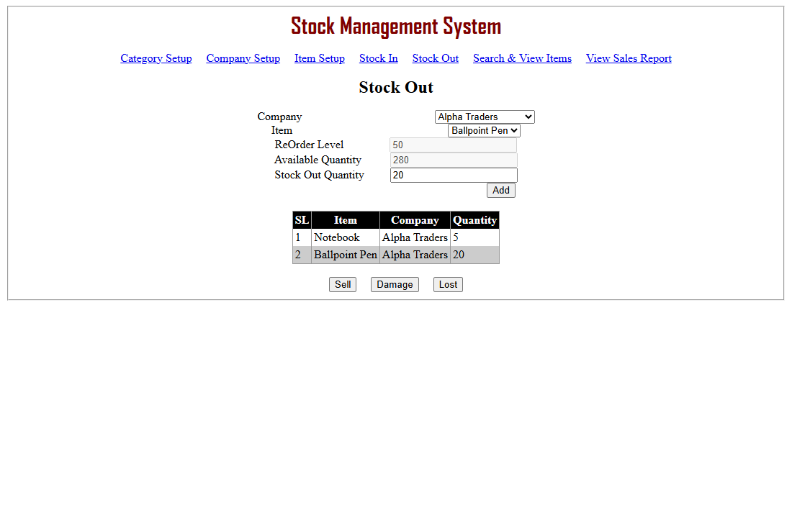
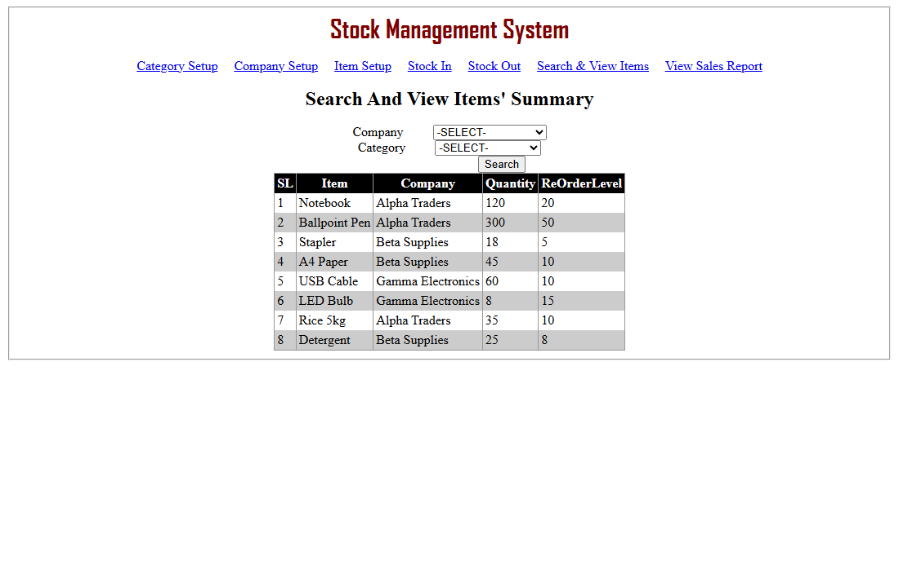
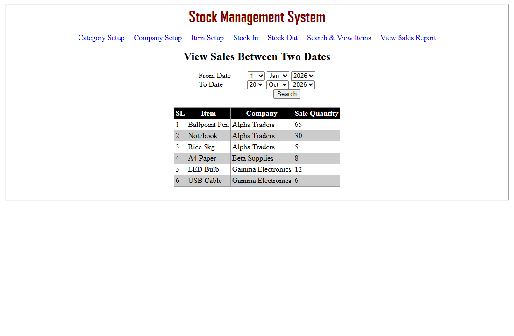

# Stock Management System

A web application for keeping track of a shop's or store's stock: categories, companies and items, stock coming in, stock going out as sales, damage or losses, a search of what is in stock, and a sales report between two dates.

I built it in 2018 with ASP.NET Web Forms, C# and SQL Server, using hand-written SQL (ADO.NET). In 2026 I came back to it, rebuilt the missing database script, and fixed the bugs I found when reviewing the code. See [What changed in 2026](#what-changed-in-2026).

## Screenshots

**Stock out.** Items go into a cart and leave stock together, as a sale, damage or loss. The available quantity already counts what is in the cart:



**Search and view items.** Stock and reorder level per item, filtered by company and category:



**Sales between two dates**, totalled per item:



## Features

- Category setup (with renaming), company setup, and item setup with a reorder level for each item
- Stock in for an item
- Stock out through a cart, saved as a sale, damage or loss
- Searching items by company and/or category, with their stock and reorder level
- Sales between two dates, totalled per item and company

## How it is built

- **ASP.NET Web Forms**: `.aspx` pages with code-behind, on .NET Framework 4.8 (4.5 in 2018)
- **Three layers**: the pages (`UI`) call managers (`BLL`) for the rules, which call gateways (`DAL/Gateway`) that run the SQL with ADO.NET and parameters; the messages shown to users live in one class (`Utility/ConstantMessage.cs`)
- **SQL Server**: four tables and two views that the pages read from
- The stock out cart is kept in the page's ViewState until it is saved

## What changed in 2026

The original Git repository was not kept. Every file in the 2018 folder carries the same date, 26 November 2018, so the history before that can't be recovered: the first commit here holds the project as it was saved that day. Everything after it is 2026 work:

1. A `.gitignore`.
2. [`Database/StockManagement.sql`](Database/StockManagement.sql): the database script, rebuilt from what the code expects, because the original was not kept.
3. Fixes for three bugs. I reproduced each one on the 2018 code first, by driving the real pages in a browser, and checked the same scenario after the fix.

| Bug | What happened with the 2018 code (local tests) | Fix |
|---|---|---|
| Stock could go below zero | With 10 notebooks, adding 4 to the cart, choosing another item and coming back showed 10 again and let 8 more in; selling left −2. Two pages each selling 6 of 10 pens both succeeded, also leaving −2. | The page counts what is already in the cart, and the stock only goes down if there is enough, checked in the same SQL statement, so the second page's sale is refused. |
| A stock out could stop half-way | The records were saved first and the stock lowered afterwards, each in its own step. With lowering the second item's stock forced to fail, both records were saved but only the first item's stock went down. | Each sale is saved in one transaction: either every item is recorded and its stock lowered, or nothing changes. |
| Sales report dates | The years only went up to 2019, so nothing after that could be reported; the 8th of the month was missing from the day lists; and an impossible date such as 31 Feb crashed the page. | The days and years are filled in by the code (up to this year), the report starts on 1 January and ends today, and an impossible date gets a message. |

4. Preparation for running it online:
   - The lists and tables now encode names. Before, a name containing HTML ran as code in the visitor's browser (on 4 pages, in a browser test).
   - A `Web.config` that runs with LocalDB and holds no passwords, and its two transform files, because the 2018 ones were not kept.
   - The project now targets .NET Framework 4.8 instead of 4.5.
   - `Default.aspx`, so the site's own address opens the app.
   - [`Database/DemoData.sql`](Database/DemoData.sql): demo data with made-up names. It can be run again at any time to reset the data.

Known limitations I have not fixed:

- There is no login, so every page is open to anyone.
- The "does this already exist?" checks are separate from saving, so two simultaneous requests could still create a duplicate.
- Item names must be unique across all companies, so two companies can't both have an item called "Pen".
- The "letters only" check for names looks only at the first character.
- Saving a category under its current name says "Already Exists".
- Stock in only changes the quantity; there is no record of what came in and when.

## Running it

You need Windows, Visual Studio 2019 or newer with ASP.NET (it includes .NET Framework 4.8), and SQL Server 2012 or newer (LocalDB is enough).

1. Create the database, add the tables, and optionally add the demo data:

   ```
   sqlcmd -S "(localdb)\MSSQLLocalDB" -Q "CREATE DATABASE StockManagement"
   sqlcmd -S "(localdb)\MSSQLLocalDB" -d StockManagement -i Database\StockManagement.sql
   sqlcmd -S "(localdb)\MSSQLLocalDB" -d StockManagement -i Database\DemoData.sql
   ```

2. Open `StockManagementProject.sln` and run it with IIS Express. `Web.config` already points at that LocalDB database. For another server, change the `StockManagementDB` connection string there.
